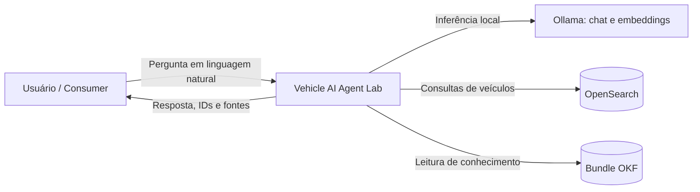
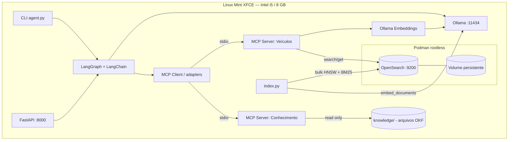
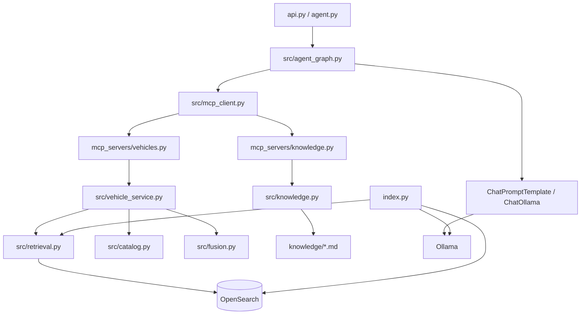
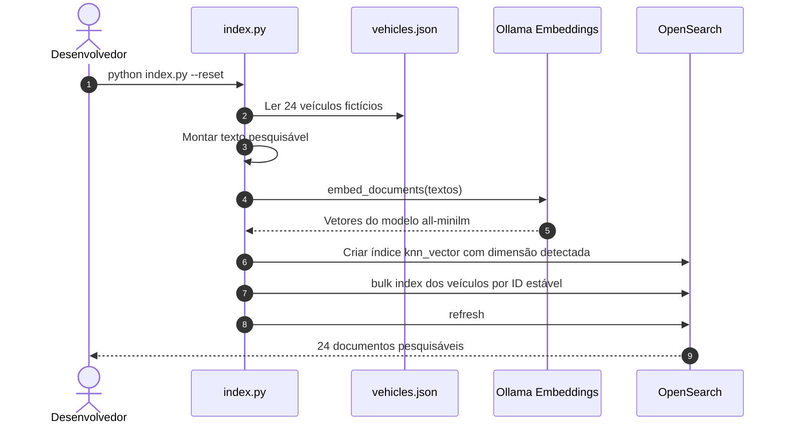
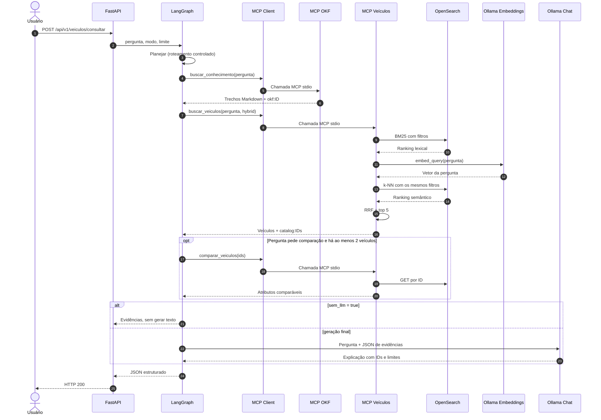
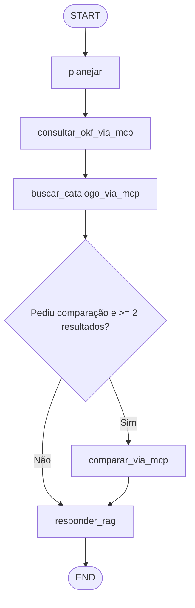

# Vehicle AI Agent Lab

**Laboratório de engenharia de IA para busca inteligente de veículos**  
`Python` · `FastAPI` · `LangGraph` · `LangChain` · `Ollama` · `MCP` · `OKF v0.2` · `OpenSearch` · `RAG híbrido` · `Podman`

> **Objetivo:** demonstrar como combinar um fluxo agêntico **controlado**, ferramentas MCP desacopladas, uma base de conhecimento OKF versionável e recuperação híbrida BM25 + k-NN no OpenSearch — executando localmente em **Linux Mint XFCE, Intel Core i5, 8 GB RAM e HD mecânico de 1 TB**.
>
> **Avisos:** todos os **24 veículos e preços são fictícios**. Não é um buscador de anúncios reais. O projeto é **educacional e local**, não possui autenticação nem configurações de segurança adequadas à exposição na internet. A integração completa com Ollama/OpenSearch exige validação no seu equipamento; os testes unitários não simulam uma execução ponta a ponta real.

## Sumário

1. [Visão de produto e arquitetura](#1-visão-de-produto-e-arquitetura)
2. [Decisões de tecnologia e responsabilidades](#2-decisões-de-tecnologia-e-responsabilidades)
3. [Arquitetura C4 — três níveis](#3-arquitetura-c4--três-níveis)
4. [Fluxos e diagramas de sequência](#4-fluxos-e-diagramas-de-sequência)
5. [Modelo de dados e estratégias de recuperação](#5-modelo-de-dados-e-estratégias-de-recuperação)
6. [MCP, contratos e tools](#6-mcp-contratos-e-tools)
7. [Bundle OKF — conhecimento como código](#7-bundle-okf--conhecimento-como-código)
8. [LangGraph: estado, nós e decisões](#8-langgraph-estado-nós-e-decisões)
9. [Estrutura e organização do projeto](#9-estrutura-e-organização-do-projeto)
10. [Instalação — Linux Mint com Podman](#10-instalação--linux-mint-com-podman)
11. [Execução pela API, CLI e RAG anterior](#11-execução-pela-api-cli-e-rag-anterior)
12. [Contratos HTTP e exemplos de respostas](#12-contratos-http-e-exemplos-de-respostas)
13. [Testes, critérios de aceite e qualidade](#13-testes-critérios-de-aceite-e-qualidade)
14. [Segurança, observabilidade e resiliência](#14-segurança-observabilidade-e-resiliência)
15. [ADRs: trade-offs e decisões arquiteturais](#15-adrs-trade-offs-e-decisões-arquiteturais)
16. [Troubleshooting do Linux Mint](#16-troubleshooting-do-linux-mint)
17. [Evolução para produção e estudos](#17-evolução-para-produção-e-estudos)
18. [Referências oficiais](#18-referências-oficiais)

---

## 1. Visão de produto e arquitetura

### Problema

Em uma busca tradicional, o usuário precisa conhecer previamente marca, modelo e filtros. Em uma jornada conversacional, pode fazer perguntas mais abertas:

> "Compare três SUVs automáticos de até R$ 100 mil para viajar com a família."

Essa consulta contém **restrições determinísticas** (`SUV`, `câmbio automático`, `R$ 100 mil`) e **preferências semânticas** (`família`, `viagens`). A arquitetura precisa tratar esses tipos de informação de maneiras diferentes.

### Resultado esperado

1. Receber a pergunta via FastAPI ou CLI.
2. Planejar a execução de ferramentas no LangGraph.
3. Recuperar regras e conceitos do bundle OKF por uma tool MCP.
4. Recuperar veículos com BM25 e k-NN no OpenSearch por outra tool MCP.
5. Executar comparação de 2–3 veículos se a consulta pedir.
6. Construir contexto do RAG a partir das evidências recuperadas.
7. Gerar resposta pelo Ollama, com IDs e fontes, sem inventar fatos ausentes.

### Princípios

- **Separation of concerns:** API, orquestração, ferramentas, recuperação, conhecimento e geração separados.
- **Knowledge as Code:** conhecimento OKF em Markdown e YAML, versionado junto ao código.
- **Guardrails por construção:** LLM não monta DSL OpenSearch, nem decide preços ou autorização.
- **Resource-aware:** apenas um contêiner pesado e modelo de chat pequeno.
- **Reprodutibilidade:** dados sintéticos, testes e comandos explícitos.
- **Auditabilidade:** identificadores `catalog:V001` e `okf:rules/suv-familiar.md`.

### O que não é esta primeira versão

Não é um agente autônomo multi-step irrestrito. A escolha de ferramentas é **determinística** dentro do LangGraph e apenas a geração final utiliza o LLM. Isso é intencional: Qwen2.5 1.5B no i5 com 8 GB não é a melhor opção para planejamento autônomo e tool calling recursivo.

---

## 2. Decisões de tecnologia e responsabilidades

| Componente | Responsabilidade | Processo/execução | Por que foi escolhido |
|---|---|---|---|
| FastAPI | HTTP, validação e OpenAPI | Host | Entrada estável, fácil teste em `/docs` |
| LangGraph | Grafo de execução e estado da pergunta | Host | Fluxo rastreável, decisões explícitas |
| LangChain | Adaptadores do LLM, prompts e integração de tools | Host | Reduz boilerplate de IA |
| Ollama / Qwen2.5 1.5B | Geração local em português | Serviço host em `11434` | Modelo pequeno, sem API externa |
| Ollama / all-minilm | Embeddings na ingestão e consulta k-NN | Serviço host em `11434` | Baixa exigência de memória |
| MCP Client | Descoberta e chamada de tools MCP via `langchain[mcp]` | Host, dentro do processo Python | Integração padronizada e reutilizável |
| MCP Server `vehicle-catalog` | Busca, detalhes e comparação, somente leitura | Subprocesso `stdio` | Capacidade de domínio bem definida |
| MCP Server `vehicle-knowledge-okf` | Recuperação lexical de conhecimento OKF | Subprocesso `stdio` | Regras fora do prompt e com fontes |
| OpenSearch 2.11.1 | BM25 + HNSW k-NN + filtros estruturados | Contêiner rootless Podman | Indexação e retrieval híbridos |
| OKF v0.2 | Formato dos documentos de conhecimento | Arquivos locais em Git | Portabilidade e proveniência |
| RRF | Fusão dos rankings BM25/k-NN | Python | Evita comparar scores incompatíveis |
| RAG | Recuperação de evidência + contexto + geração | Fluxo LangGraph | Reduz dependência da memória paramétrica do LLM |

**Não confundir os conceitos:** OKF é um **formato de representação de conhecimento**, não um motor de inferência nem um banco de dados. MCP é um **protocolo**, não o mecanismo de ranking. RAG é um **padrão de arquitetura**, não um componente executável separado.

---

## 3. Arquitetura C4 — três níveis

### C4 — Nível 1: contexto do sistema



**Contexto:** o cliente não precisa conhecer as ferramentas internas; recebe uma resposta e dados estruturados de evidência. Os serviços estão na máquina local.

### C4 — Nível 2: contêineres e processos



**Implantação:** `MCP stdio` cria subprocessos locais sob demanda; eles não abrem portas HTTP. A API roda somente com `--host 127.0.0.1`. OpenSearch publica a porta somente em loopback. Não há PostgreSQL, Redis, Kafka ou serviços adicionais nesta versão, para preservar RAM.

### C4 — Nível 3: componentes Python



**Direção de dependências:** orquestrador depende de contratos de tools; a lógica de domínio não depende de FastAPI ou MCP; adaptadores MCP traduzem chamadas para casos de uso; arquivos OKF são material consumido, não código executado.

---

## 4. Fluxos e diagramas de sequência

### Fluxo A — indexar catálogo no OpenSearch



`--reset` **apaga exclusivamente o índice de laboratório** configurado em `.env`. É obrigatório quando mudar o modelo de embedding, inclusive se a dimensão permanecer igual. O índice do laboratório anterior deve ser recriado com o mesmo embedding indicado nesta documentação.

### Fluxo B — pergunta, MCP, recuperação e resposta



### Fluxo C — quando o OpenSearch não encontra resultados

1. A tool `buscar_veiculos` retorna lista vazia.
2. O grafo não tenta comparar veículos inexistentes.
3. O nó final retorna mensagem de ausência de candidatos.
4. **Não** relaxa filtros automaticamente e não inventa resultados.

---

## 5. Modelo de dados e estratégias de recuperação

### Fonte do catálogo

`data/vehicles.json` contém 24 veículos sintéticos, com IDs estáveis como `V001`. Registro simplificado:

```json
{
  "id": "V001",
  "marca": "fiat",
  "modelo": "Pulse",
  "versao": "Drive 1.3",
  "ano": 2023,
  "preco": 89000,
  "km": 29000,
  "carroceria": "suv",
  "cambio": "automatico",
  "combustivel": "flex",
  "destaques": "compacto, central multimídia, consumo equilibrado",
  "descricao": "SUV compacto para uso urbano e viagens curtas em família."
}
```

### Mapeamento OpenSearch

| Campo | Tipo | Finalidade |
|---|---|---|
| `_id`, `id` | Identificador | Referência da evidência |
| `marca` | `text` + `keyword` | Busca e filtro |
| `modelo`, `versao` | `text` | Relevância lexical |
| `ano`, `preco`, `km` | `integer` | Filtros `range` |
| `carroceria`, `cambio`, `combustivel` | `keyword` | Filtros `term` |
| `destaques`, `descricao` | `text` | Contexto semântico |
| `texto_busca` | `text` com analyzer `brazilian` | BM25 |
| `vetor` | `knn_vector`, Lucene HNSW, cosseno | Recuperação semântica |

**BM25:** `multi_match` com pesos distintos para marca, modelo, versão e texto agregado.  
**k-NN:** a consulta é vetorizada pelo Ollama; o índice utiliza HNSW em mecanismo Lucene com filtros aplicados na operação k-NN.  
**RRF:** fusiona posições e evita misturar escalas de score.

```text
RRF(documento) = Σ [ 1 / (60 + posição_no_ranking) ]
```

O documento que aparece bem posicionado em duas listas tende a subir no resultado final. Cada lista tem no máximo `TOP_K=8` candidatos, e a fusão devolve até `limite=5` registros.

### Exemplos de critérios estruturados

| Pergunta | Filtros determinísticos esperados |
|---|---|
| "SUV automático até R$ 100 mil" | `carroceria=suv`, `cambio=automatico`, `preco_max=100000` |
| "Toyota a partir de 2021 até R$ 120.000" | `marca=toyota`, `ano_min=2021`, `preco_max=120000` |
| "Picape diesel acima de 80 mil" | `carroceria=picape`, `combustivel=diesel`, `preco_min=80000` |

O parser é **propositalmente restrito e baseado em regex**. Não cobre toda a língua portuguesa, sinônimos ou filtros compostos complexos. Em produção, preferir filtros explícitos na API ou um extractor estruturado validado por schema e rechecado no backend.

### Importante: não existem atributos não modelados

O catálogo não contém capacidade do porta-malas em litros, consumo homologado, avaliações reais de segurança, estoque ou localização. O LLM deve informar ausência de dados; não existe autorização para inferir números a partir de conhecimento geral.

---

## 6. MCP, contratos e tools

### Servidores MCP

| Servidor | Tool | Parâmetros | Fonte consultada |
|---|---|---|---|
| `vehicle-catalog` | `buscar_veiculos` | `pergunta`, `modo`, `limite` | OpenSearch BM25/k-NN |
| `vehicle-catalog` | `detalhar_veiculo` | `id_veiculo` | OpenSearch `get` |
| `vehicle-catalog` | `comparar_veiculos` | `ids: list[str]` (2–3) | OpenSearch `get` |
| `vehicle-knowledge-okf` | `buscar_conhecimento` | `pergunta`, `limite` | `knowledge/**/*.md` |
| `vehicle-knowledge-okf` | `listar_conceitos` | — | Metadados dos documentos OKF |

### Por que dois servidores?

- Catálogo tem responsabilidades de busca e leitura de documentos do índice.
- Conhecimento OKF tem responsabilidade de leitura de regras e conceitos em disco.
- Os dois podem evoluir e ser reutilizados por outros clientes MCP sem acoplar o domínio ao LangGraph.
- O protocolo é **stdio local**, não HTTP. Evita serviços residentes, portas e consumo adicionais.

O `MCPAdapter` do `langchain.mcp` conecta aos servidores e converte suas ferramentas em objetos compatíveis com LangChain/LangGraph. A chamada ocorre por `tool.ainvoke(...)`; o grafo interpreta o JSON retornado. Os dois servidores são **somente leitura**. O adaptador prefixa ferramentas de vários servidores; `src/mcp_client.py` converte nomes como `veiculos_buscar_veiculos` para os nomes de domínio usados pelo grafo.

### Contrato de `buscar_veiculos` (exemplo)

Entrada:

```json
{"pergunta":"SUV automático até R$ 100 mil", "modo":"hybrid", "limite":3}
```

Saída resumida ilustrativa:

```json
{
  "mode": "hybrid",
  "filters": {"carroceria": "suv", "cambio": "automatico", "preco_max": 100000},
  "vehicles": [{"id":"V001", "marca":"fiat", "modelo":"Pulse", "preco":89000}],
  "sources": ["catalog:V001"]
}
```

**Não é um resultado medido:** a ordenação/quantidade concreta dependem da consulta e do índice local. A tool devolve campos explícitos por allowlist e **não devolve embeddings**.

### Executar servidores MCP manualmente

Usualmente o cliente inicia os processos automaticamente. Para inspecionar um servidor, os comandos abaixo ficam aguardando mensagens do protocolo via stdin e **não imprimem interface interativa**:

```bash
python -m mcp_servers.vehicles
python -m mcp_servers.knowledge
```

Use dois terminais diferentes apenas para investigação. Não é necessário mantê-los abertos quando iniciar `agent.py` ou `api.py`.

---

## 7. Bundle OKF — conhecimento como código

O **Open Knowledge Format v0.2**, mantido no projeto `GoogleCloudPlatform/open-knowledge-format`, representa conhecimento em arquivos Markdown com frontmatter YAML. Não exige um vector store próprio. O leitor de `src/knowledge.py` realiza **recuperação lexical simples**; para um corpus maior seria possível criar um índice textual/vetorial dos conceitos, sem mudar o formato fonte.

Estrutura:

```text
knowledge/
├── index.md
├── log.md
├── rules/
│   ├── orcamento.md
│   ├── suv-familiar.md
│   └── confiabilidade.md
├── concepts/
│   ├── busca-hibrida.md
│   └── campos-catalogo.md
└── decisions/
    └── filtros-deterministicos.md
```

Exemplo de conceito `knowledge/rules/suv-familiar.md` (trecho):

```markdown
---
type: Business Rule
title: Critérios ilustrativos para SUV familiar
description: Critérios de comparação para uso familiar.
tags: [suv, familia, viagem, seguranca]
status: draft
---

# SUV familiar

Não inferir nota de segurança ou capacidade do porta-malas
sem dados observáveis no catálogo.
```

### Conformidade, autoria e confiança

- Documentos de conceito devem ter YAML válido e `type` não vazio.
- `index.md` e `log.md` são nomes reservados no bundle.
- `status: draft` indica que o conteúdo é demonstrativo, não uma regra homologada.
- Não há eventos `verified` inventados; na ausência deles o conceito permanece **não verificado** no sentido de OKF.
- As fontes retornam identificadores relativos (`okf:rules/...`) sem dar acesso ao filesystem arbitrário.
- Leitor utiliza `Path.resolve().relative_to(...)` para evitar acesso fora da raiz do bundle.

Validação local:

```bash
python -m scripts.validate_okf
```

A busca OKF atual usa interseção de tokens, **não embeddings**. Isso é desejável no i5/8GB, mas tem limitação semântica: sinônimos que não compartilhem termos podem não retornar documentos.

---

## 8. LangGraph: estado, nós e decisões

### Workflow controlado



### Por que o LLM não escolhe as tools livremente?

Para tornar a solução previsível com `qwen2.5:1.5b` e facilitar testes. `planejar` identifica a intenção de comparação por regras simples. Consultas de conhecimento e catálogo são executadas de maneira fixa para demonstrar integração entre MCPs. É um **workflow agêntico com ferramentas**, não uma implementação de ReAct autônomo.

### Estado principal (`AgentState`)

| Campo | Tipo | Finalidade |
|---|---|---|
| `pergunta` | `str` | Texto original do usuário |
| `modo` | `str` | `hybrid`, `bm25`, `vector` |
| `limite` | `int` | 1–5 veículos |
| `sem_llm` | `bool` | Desliga somente geração final |
| `plano` | `list[str]` | Etapas decididas |
| `comparar` | `bool` | Ramo condicional |
| `conhecimento` | `list[dict]` | Conceitos OKF e fontes |
| `veiculos` | `list[dict]` | Resultados do catálogo |
| `filtros` | `dict` | Restrições determinísticas |
| `comparacao` | `dict` | Dados estruturados de comparação |
| `fontes` | `list[str]` | IDs de evidência |
| `resposta` | `str` | Saída final |

### Limites do comportamento

- `--sem-llm` impede **ChatOllama**, mas não impede o modelo de embeddings nos modos `vector` e `hybrid`.
- No modo `bm25`, o fluxo de consulta não precisa de embeddings; **a indexação** inicial ainda precisa do embedding para criar o índice híbrido.
- O grafo atual é sequencial: mais fácil estudar latência por nó, mais lento que execução paralela.
- O código não contém checkpoint persistente nem histórico de múltiplas rodadas: cada consulta inicia um novo estado.
- Erros de uma ferramenta não são disfarçados com resultados inventados. API responde 503 e registra a falha localmente.

---

## 9. Estrutura e organização do projeto

```text
vehicle-ai-agent-lab/
├── README.md                     # Documentação e arquitetura
├── compose.yaml                  # OpenSearch com imagem docker.io explícita
├── requirements.txt              # Dependências Python (sem PyTorch)
├── .env.example                  # Configuração de execução
├── .gitignore
├── api.py                        # FastAPI / health / consulta
├── agent.py                      # CLI do agente MCP + OKF
├── index.py                      # Geração de embeddings e indexação
├── rag.py                        # Laboratório RAG anterior (comparação)
├── data/
│   └── vehicles.json            # 24 veículos fictícios
├── src/
│   ├── agent_graph.py           # Orquestração LangGraph
│   ├── planning.py              # Planejamento determinístico
│   ├── mcp_client.py            # Adapter MCP -> LangChain
│   ├── vehicle_service.py       # Casos de uso e validação de IDs
│   ├── knowledge.py             # Parser e busca de conceitos OKF
│   ├── catalog.py               # Regras de filtros determinísticas
│   ├── retrieval.py             # Consultas BM25/k-NN
│   ├── fusion.py                # Reciprocal Rank Fusion
│   └── config.py                # Variáveis de ambiente
├── mcp_servers/
│   ├── vehicles.py              # Tool Server MCP do catálogo
│   └── knowledge.py             # Tool Server MCP OKF
├── knowledge/                    # Bundle OKF v0.2
│   ├── index.md
│   ├── log.md
│   ├── rules/
│   ├── concepts/
│   └── decisions/
├── scripts/
│   ├── doctor.sh                # Verificações do host
│   ├── mcp_smoke.py             # Handshake com servidores MCP
│   └── validate_okf.py          # Validação estrutural
└── tests/                        # Testes sem contêiner/modelos
    ├── test_catalog.py
    ├── test_rrf.py
    ├── test_knowledge.py
    ├── test_service.py
    ├── test_planning.py
    └── test_graph_logic.py
```

### Boundaries

- **API adapter:** `api.py`, HTTP/Pydantic e erros públicos.
- **Application layer:** `src/agent_graph.py`, `src/planning.py` e `src/vehicle_service.py`, orquestração/casos de uso.
- **Infrastructure adapters:** `src/retrieval.py`, `src/mcp_client.py` e servidores MCP.
- **Knowledge/data:** `knowledge/` (semântica) e `data/` (catálogo de exemplo).

Não chamamos isso de Clean Architecture estrita: os módulos possuem dependências diretas de SDKs e não definimos portas/interfaces formais para todos os componentes. É uma separação pragmática compatível com um laboratório de estudos.

---

## 10. Instalação — Linux Mint com Podman

### Pré-requisitos

- Linux Mint XFCE em um disco de 1 TB, com pelo menos alguns GB de espaço livre (mais espaço pode ser necessário conforme os modelos baixados).
- Intel Core i5 com 8 GB de RAM (sem GPU exigida).
- Python 3.11+ e `python3-venv`.
- `podman`, **`podman-compose`** (com hífen, não o `docker-compose` antigo).
- `curl`, `ollama`, conexão para baixar as imagens/modelos na instalação.

> **Atenção:** não execute `sudo podman-compose` no modo rootless. No seu ambiente anterior, `podman compose` (com espaço) chamava `/usr/bin/docker-compose` 1.29.2 e falhava em Python 3.12 por falta de `distutils`. Use explicitamente **`podman-compose`**.

### Etapa 0 — diagnóstico

```bash
cd vehicle-ai-agent-lab
bash scripts/doctor.sh
free -h
df -h /
```

Se o HD estiver cheio, não prossiga com a indexação. Não reinstale PyTorch neste projeto: usamos **embeddings via Ollama**, sem `sentence-transformers`.

### Etapa 1 — configurar kernel para OpenSearch

```bash
sudo sysctl -w vm.max_map_count=262144
```

Para persistir entre reinicializações (se necessário):

```bash
printf 'vm.max_map_count=262144\n' | sudo tee /etc/sysctl.d/99-opensearch-lab.conf
sudo sysctl --system
```

### Etapa 2 — instalar Podman Compose (se ainda não houver)

```bash
sudo apt update
sudo apt install -y podman podman-compose python3-venv curl
podman-compose --version
```

### Etapa 3 — iniciar somente o OpenSearch

O `compose.yaml` usa `docker.io/opensearchproject/opensearch:2.11.1`, evitando o erro do Podman **`short-name ... did not resolve to an alias`**.

```bash
podman pull docker.io/opensearchproject/opensearch:2.11.1
podman-compose up -d
podman ps
curl -fsS http://localhost:9200
curl -fsS http://localhost:9200/_cluster/health?pretty
```

O OpenSearch inicia com heap Java de `512m` (`-Xms512m -Xmx512m`). **Isso não limita o consumo total do contêiner a 512 MB**: processo, buffers, sistema de arquivos e índices vetoriais também consomem RAM. Monitore com `free -h`, `podman stats` e `podman logs vehicle-agent-opensearch`.

### Etapa 4 — iniciar Ollama no host

```bash
ollama --version
sudo systemctl enable --now ollama
curl -fsS http://localhost:11434/api/tags
ollama pull qwen2.5:1.5b
ollama pull all-minilm
ollama list
```

Se o serviço Ollama não foi instalado como `systemd`, execute `ollama serve` em outro terminal. Se os modelos já estiverem instalados, não é necessário repetir o download.

**Memória:** para diminuir a concorrência de carregamento de modelos, opcionalmente configure `OLLAMA_MAX_LOADED_MODELS=1` no serviço Ollama e reinicie o serviço. Isso pode fazer chat e embeddings alternarem carregamento, aumentando a latência no HD mecânico, mas reduzindo o pico de memória.

### Etapa 5 — ambiente Python limpo

```bash
cd vehicle-ai-agent-lab
python3 -m venv .venv
source .venv/bin/activate
python -m pip install --upgrade pip
python -m pip install -r requirements.txt
cp .env.example .env
python -m pip check
```

**Este laboratório não requer:** Hugging Face token, PyTorch, `transformers`, CUDA, `sentence-transformers` ou `ordeq_sentence_transformers`. Caso um pacote grande seja baixado, confirme que está instalando o `requirements.txt` **deste** projeto, não do laboratório RAG anterior.

### Etapa 6 — validar e indexar

```bash
python -m scripts.validate_okf
python -m scripts.mcp_smoke
python index.py --reset
curl -s 'http://localhost:9200/lab_veiculos_rag/_count?pretty'
```

Esperado: `count` igual a **24**. `--reset` apaga o índice configurado e recria seus mappings e embeddings. Sem `--reset`, o indexador insere/atualiza por IDs estáveis. A dimensão é detectada a partir do modelo de embeddings.

### Etapa 7 — rodar testes

```bash
python -m pytest -q
```

Esses testes rodam sem OpenSearch ou Ollama (e alguns testam lógica pura). Para validação ponta a ponta, execute também uma consulta real pela CLI e pela API.

---

## 11. Execução pela API, CLI e RAG anterior

### Modo 1: agente completo via CLI

```bash
python agent.py --modo hybrid \
  --pergunta "Compare três SUVs automáticos de até R$ 100 mil para minha família"
```

O que acontece: lê OKF via MCP, busca candidatos via MCP/OpenSearch, executa comparação quando aplicável e envia as evidências ao Qwen via LangChain.

### Modo 2: apenas retrieval, sem gerar resposta

```bash
python agent.py --modo bm25 --sem-llm \
  --pergunta "SUV automático até R$ 90 mil"
```

Esse modo é mais leve na **consulta**, pois não executa chat nem embedding da pergunta. Ele ainda acessa o OpenSearch e o servidor MCP.

### Modo 3: iniciar API REST

```bash
python -m uvicorn api:app --host 127.0.0.1 --port 8000
```

Acessos locais:

- [Swagger UI](http://127.0.0.1:8000/docs)
- [OpenAPI JSON](http://127.0.0.1:8000/openapi.json)
- [Health](http://127.0.0.1:8000/health)

### Modo 4: utilizar o RAG original para comparação

```bash
python rag.py --modo hybrid \
  --pergunta "Quero um SUV automático até R$ 100 mil" --sem-llm
```

Este arquivo foi preservado do laboratório anterior e **não passa por MCP nem consulta OKF**. Ele é um ótimo baseline para comparar latência e complexidade do fluxo anterior com a evolução agêntica.

---

## 12. Contratos HTTP e exemplos de respostas

### `GET /health`

```bash
curl -fsS http://127.0.0.1:8000/health
```

Retorno:

```json
{
  "status": "alive",
  "message": "Processo FastAPI operacional; dependências não verificadas"
}
```

**Atenção:** esse health é um *liveness*, não um *readiness*. HTTP 200 aqui não prova que OpenSearch, Ollama ou os servidores MCP estejam prontos.

### `POST /api/v1/veiculos/consultar`

```bash
curl -sS -X POST 'http://127.0.0.1:8000/api/v1/veiculos/consultar' \
  -H 'Content-Type: application/json' \
  -d '{
    "pergunta": "Compare três SUVs automáticos de até R$ 100 mil para a família",
    "modo": "hybrid",
    "limite": 3,
    "sem_llm": false
  }'
```

A resposta contém:

```json
{
  "pergunta": "Compare três SUVs automáticos de até R$ 100 mil para a família",
  "modo": "hybrid",
  "plano": ["buscar_conhecimento", "buscar_veiculos", "comparar_veiculos", "responder"],
  "filtros": {"carroceria": "suv", "cambio": "automatico", "preco_max": 100000},
  "veiculos": [],
  "conhecimento": [],
  "comparacao": {},
  "fontes": [],
  "resposta": "..."
}
```

O JSON acima é **um exemplo de estrutura, não resultado de execução**. Em uma consulta real, as listas e a resposta são preenchidas pelos serviços. Campos opcionais, como `comparacao`, podem ser omitidos se o ramo não for executado.

### Códigos HTTP

| Código | Significado |
|---|---|
| `200` | Fluxo concluído; pode conter zero candidatos |
| `422` | Entrada fora dos limites de validação |
| `503` | Alguma dependência/tool falhou; consultar logs |

Não existe negociação de preço, pagamento, reserva ou ação de escrita neste projeto.

---

## 13. Testes, critérios de aceite e qualidade

### Testes unitários

```bash
python -m pytest -q
```

| Família | Escopo | Dependência externa? |
|---|---|---|
| Catálogo | Extração de preço, ano, câmbio e quilometragem | Não |
| RRF | Deduplicação e priorização de resultados comuns | Não |
| OKF | Frontmatter, busca lexical, fonte e path traversal | Não |
| Serviço de veículos | Modos de busca, allowlist e formato de IDs com fakes | Não |
| Documentação | Presença das seções arquiteturais | Não |

### Critérios de aceite de integração (executar localmente)

- [ ] `podman ps` mostra `vehicle-agent-opensearch` em execução.
- [ ] `curl localhost:9200` retorna JSON válido.
- [ ] `ollama list` contém `qwen2.5:1.5b` e `all-minilm`.
- [ ] `python -m scripts.validate_okf` encontra os conceitos tipados.
- [ ] `python -m scripts.mcp_smoke` descobre as cinco ferramentas MCP, sem acessar OpenSearch.
- [ ] `python index.py --reset` indexa 24 veículos.
- [ ] `python agent.py --modo bm25 --sem-llm ...` retorna candidatos.
- [ ] `python agent.py --modo hybrid ...` retorna candidatos, fontes e resposta.
- [ ] `curl POST /api/v1/veiculos/consultar` produz JSON válido.
- [ ] Preço máximo é respeitado nos registros retornados.
- [ ] Ausência de resultados não produz veículos fictícios adicionais.

### Como avaliar ranking e qualidade (evolução)

1. Construir conjunto de perguntas de referência (intent, filtros esperados, IDs relevantes).
2. Medir `Recall@K`, `MRR` e `nDCG@K` para BM25, vetor e híbrido.
3. Medir precisão dos filtros estruturados separadamente.
4. Medir latência P50/P95 da busca, geração de embeddings e geração de resposta.
5. Avaliar *groundedness*: toda afirmação de veículo deve ter respaldo em `catalog:ID` ou conceito OKF.

---

## 14. Segurança, observabilidade e resiliência

### Ameaças e controles iniciais

| Risco | Mitigação implementada | Limite |
|---|---|---|
| Prompt injection em conhecimento/catalogo | Prompt separa dados de instruções; tools fixas por código | Prompt não é barreira de segurança completa |
| LLM gerar consulta perigosa | Não recebe acesso a OpenSearch DSL genérico | Parser atual não cobre toda a linguagem |
| Path traversal em arquivos OKF | Leitor restrito à raiz `knowledge/` | Validar permissões do host |
| Vazamento de embeddings ou campos não previstos | Allowlist de campos de resposta | Dados de exemplo não contêm dados sensíveis |
| Custos/loops de agentes | Grafo acíclico e top K limitado | Não há rate limiting HTTP nesta versão |
| Exposição de serviço sem login | Bind local `127.0.0.1` e OpenSearch sem security apenas local | Não publicar na rede |
| Alucinação de dados de veículos | Prompt exige evidência e IDs | Precisão do LLM deve ser aferida |

**Modelo de confiança:** a tool MCP é uma fronteira de dados. Conhecimento externo ou texto de veículo não deve determinar instruções executáveis nem ampliar permissões. Em produção: autenticação, autorização, auditoria de chamadas de ferramentas, timeouts, limite de taxa e validação de retornos.

### Observabilidade atual versus proposta

**Disponível:** logs de erro da API no terminal, IDs de fontes, respostas estruturadas, saída do Podman e do Ollama.  
**Não disponível:** tracing distribuído, correlation ID, métricas Prometheus, OpenTelemetry, dashboard ou limites por usuário.

Evoluções recomendadas: `trace_id` propagado API → grafo → MCP, métricas por nó, logs JSON, OpenTelemetry, histogramas P50/P95/P99 e testes de indisponibilidade de tools.

### Resiliência e recuperação

- `GET /health` verifica apenas que o processo FastAPI responde.
- Consulta MCP/OpenSearch/Ollama com falha causa erro HTTP 503, não resposta inventada.
- `podman-compose up -d` recria o serviço sem apagar dados persistidos no volume.
- `podman-compose down` interrompe o ambiente e preserva volumes, por padrão.
- `podman-compose down -v` **apaga o volume** e exigirá indexação novamente: evite se não quiser perder os índices.

---

## 15. ADRs: trade-offs e decisões arquiteturais

### ADR-001 — OpenSearch híbrido em vez de somente vetor

**Decisão:** usar BM25 e Lucene k-NN com filtros e RRF.  
**Motivo:** usuários combinam nomes exatos com necessidades semânticas.  
**Trade-off:** exige dois mecanismos de recuperação, embeddings na ingestão/consulta e mais custo de CPU/memória.

### ADR-002 — LangGraph como orquestrador, LangChain como integração

**Decisão:** grafo explícito controla branches, ferramentas e estado.  
**Motivo:** depuração, testes, previsibilidade e limites.  
**Trade-off:** menor flexibilidade para perguntas inesperadas que um agente ReAct dinâmico.

### ADR-003 — Dois MCP Servers somente leitura

**Decisão:** catálogo e conhecimento separados; transporte `stdio`.  
**Motivo:** baixo overhead no i5, reutilização das tools e menos superfície exposta.  
**Trade-off:** inicialização de subprocessos por consulta e ausência de multiplexação HTTP remota.

### ADR-004 — OKF versionado no Git

**Decisão:** manter regras e conceitos em Markdown/YAML, não hard-coded em prompts.  
**Motivo:** revisão de domínio, rastreabilidade, diff e portabilidade.  
**Trade-off:** mecanismo de recuperação local é lexical; falta busca semântica em grandes bundles. O OKF não aplica sozinho regras executáveis.

### ADR-005 — Modelo local Qwen2.5 1.5B

**Decisão:** executar inferência final local via Ollama.  
**Motivo:** laboratório acessível com 8 GB de RAM e sem API paga.  
**Trade-off:** menor qualidade e maior risco de desobedecer formato/instruções do que modelos maiores; resposta mais lenta no HD mecânico.

### ADR-006 — Restrições de preço e câmbio determinísticas

**Decisão:** extrair filtros via parser controlado e aplicar `term`/`range` no OpenSearch.  
**Motivo:** evitar que LLM recomende veículo acima do limite por plausibilidade semântica.  
**Trade-off:** expressões fora das regex não são compreendidas; não substitui linguagem natural avançada com schema validado.

### ADR-007 — Apenas OpenSearch em contêiner

**Decisão:** Ollama, API e tools Python no host; OpenSearch via Podman.  
**Motivo:** menos camadas e facilidade de diagnóstico em equipamento restrito.  
**Trade-off:** menor portabilidade do setup de inferência; requer instalar o Ollama no Mint.

---

## 16. Troubleshooting do Linux Mint

### `ModuleNotFoundError: No module named 'distutils'` em `podman compose up -d`

O Podman escolheu o Docker Compose legado `/usr/bin/docker-compose` 1.29.2, incompatível com Python 3.12. **Não reinstale nem modifique o Python do sistema.** Execute o provedor correto diretamente:

```bash
sudo apt install -y podman-compose
podman-compose --version
podman-compose up -d
```

Se precisar usar `podman compose` com espaço, force o provedor na sessão atual:

```bash
export PODMAN_COMPOSE_PROVIDER="$(command -v podman-compose)"
podman compose up -d
```

### `short-name "opensearchproject/opensearch" did not resolve to an alias`

O Compose **deste projeto** já usa `docker.io/opensearchproject/opensearch:2.11.1`:

```bash
podman pull docker.io/opensearchproject/opensearch:2.11.1
podman-compose up -d
```

### OpenSearch não sobe ou não responde na porta 9200

```bash
podman ps -a
podman logs --tail 120 vehicle-agent-opensearch
free -h
sudo sysctl vm.max_map_count
```

Verifique memória e se `vm.max_map_count >= 262144`. No HD mecânico, a primeira inicialização pode levar mais tempo. O heap 512m é experimental e pode exigir ajuste segundo os logs.

### `OSError: [Errno 28] No space left on device`

```bash
df -h /
python -m pip cache purge
podman system df
```

Não execute `podman system prune -a --volumes` sem avaliar o que será apagado: ele pode remover imagens e volumes de outros laboratórios. Mantenha espaço livre para OpenSearch, modelos Ollama e temporários.

### `filelock ... unexpected keyword argument 'mode'` / Hugging Face

São sintomas do laboratório anterior com `sentence-transformers`. **Este projeto não usa Hugging Face**, PyTorch ou CUDA. Crie um `.venv` limpo conforme a Etapa 5.

### Ollama não encontrado ou modelo inexistente

```bash
command -v ollama
ollama --version
ollama list
curl http://localhost:11434/api/tags
sudo systemctl status ollama
```

Depois baixe `qwen2.5:1.5b` e `all-minilm` conforme a instalação. Se o Ollama não for um serviço, execute `ollama serve` em outro terminal.

### Falha em tools MCP / `stdio`

- Use `source .venv/bin/activate` antes de executar CLI/API.
- Execute tudo da raiz `vehicle-ai-agent-lab`.
- Confira `python -m pip check` e o Python do venv com `which python`.
- Os dois MCP Servers são subprocessos que usam **o mesmo interpretador Python** (`sys.executable`).
- `fastmcp>=4,<5` oferece o servidor `FastMCP`; `langchain[mcp]>=1.4` usa o `MCPAdapter` (API ainda beta). Guias do antigo `langchain-mcp-adapters` estão arquivados e não devem ser misturados com esta implementação.
- `stdio` reserva stdout para mensagens do protocolo: debug de servidor deve ir ao stderr/logging.

### O notebook fica lento / swap excessiva

```bash
free -h
swapon --show
podman stats
ps aux --sort=-rss | head
```

Primeiro teste com `--modo bm25 --sem-llm`. Depois teste `hybrid --sem-llm` e, por último, a geração completa. Com 8 GB, evite executar IDE pesada, navegador com várias abas e outros contêineres simultaneamente. O HD mecânico tende a tornar as operações de swap especialmente lentas.

---

## 17. Evolução para produção e estudos

| Etapa | Evolução | Benefício / aprendizado |
|---|---|---|
| V1 — este projeto | Workflow controlado, stdio MCP, OKF local, retrieval híbrido, Ollama | Entender fronteiras e contratos |
| V2 | Métricas e tracing por nó, testes de integração real, golden datasets | Observabilidade e qualidade |
| V3 | Chunking e vetorização opcional dos conceitos OKF | Escalar base de conhecimento |
| V4 | Tool selection dinâmica com modelo maior, budget de chamadas, aprovação humana | Agente parcialmente autônomo |
| V5 | OAuth, RBAC, auditoria, rate limit, isolamento de MCP, TLS | Segurança corporativa |
| V6 | Conversas multi-turno e checkpointer persistente (com avaliação) | Estado e continuidade |
| V7 | OpenSearch distribuído, pipelines de ingestão, alias, blue/green, SLO | Escalabilidade e operação |

**Exercícios para entrevista de arquiteto:**

1. Por que índices invertidos e vetoriais não são substitutos perfeitos?
2. Qual o trade-off de usar RRF no Python versus pipeline de rank fusion no OpenSearch?
3. Como garantir que filtros de negócio não sejam enfraquecidos pelo LLM?
4. Qual a diferença entre conhecimento OKF, tool MCP e contexto recuperado por RAG?
5. Como proteger o MCP Server contra prompt injection e chamadas indevidas?
6. Por que escolher LangGraph com workflow determinístico para modelos pequenos?
7. Qual seria o plano de capacidade e observabilidade para 100–10.000 requisições/dia?

---

## 18. Referências oficiais

- [OKF — especificação canônica v0.2](https://github.com/GoogleCloudPlatform/open-knowledge-format/blob/main/SPEC.md)
- [MCP Python SDK — documentação atual](https://py.sdk.modelcontextprotocol.io/)
- [MCP SDK — servidores e transporte stdio](https://py.sdk.modelcontextprotocol.io/run/)
- [LangChain MCP — integração mantida (`MCPAdapter`)](https://docs.langchain.com/oss/python/langchain/mcp)
- [Migração da biblioteca antiga `langchain-mcp-adapters`](https://docs.langchain.com/oss/python/migrate/langchain-mcp-adapters)
- [FastMCP 4 — documentação](https://gofastmcp.com/)
- [LangGraph Python](https://docs.langchain.com/oss/python/langgraph/overview)
- [LangChain Ollama](https://docs.langchain.com/oss/python/integrations/chat/ollama)
- [OpenSearch — indexação vetorial](https://docs.opensearch.org/latest/vector-search/creating-vector-index/)
- [OpenSearch — filtros eficientes k-NN](https://docs.opensearch.org/latest/vector-search/filter-search-knn/)
- [Podman Compose](https://docs.podman.io/en/latest/markdown/podman-compose.1.html)

---

**Status da entrega:** código e documentação fornecidos para execução local. Os testes isolados verificam lógica de domínio e conhecimento; a integração operacional real com MCP, Ollama, LangGraph e OpenSearch **precisa ser validada no seu Linux Mint após instalar dependências, modelos e contêiner**. Não se declara desempenho, ranking ou resposta de LLM sem medição.
